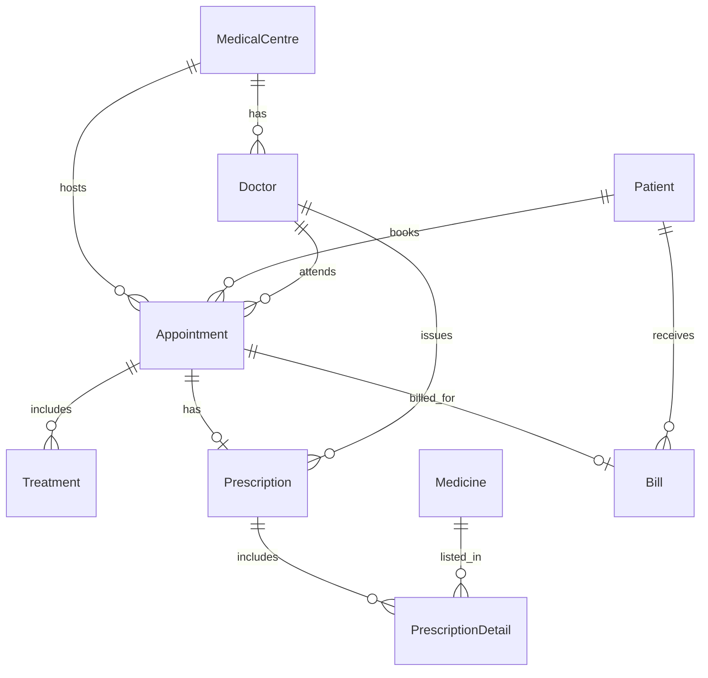

# SmartCareDB 🏥
### SmartCare Medical Centre — Database Management System

A **relational database design and SQL implementation** for a multi-branch medical centre. Built with **MySQL** as part of the **H7DX — Database Management Systems** assessment, SmartCareDB models patient registration, doctor assignments, appointment scheduling, treatments, prescriptions, medicines, and billing.

> **Project type:** Database schema / SQL coursework — not a complete web application. The supplied script creates the database structure; it does not include sample data or a user interface.

## 📌 Project Overview

SmartCare Medical Centre needs a centralized way to organize information that would otherwise be held in spreadsheets and paper records. This project provides a relational schema intended to:

- Structure medical centre, patient, and doctor information.
- Connect appointments with their patient, doctor, and centre.
- Record treatments and prescriptions linked to appointments.
- Track medicines prescribed and quantities/instructions.
- Associate bills and payment details with appointments.
- Apply primary keys, foreign keys, uniqueness rules, and basic data-integrity constraints.

## 🛠️ Technologies

| Category | Technology |
| --- | --- |
| Database | MySQL (also intended for compatible MariaDB versions) |
| Query language | SQL (DDL) |
| Local environment | XAMPP / phpMyAdmin (optional) |
| Version control | Git & GitHub |

## 🗂️ Repository Structure

```text
SmartCareDB/
├── README.md         # Project documentation
├── smartcaredb.sql   # Database creation and table definitions
└── .gitignore        # Local files to exclude from Git
```

## 🧩 Database Tables

The script defines **9 tables**:

| Table | Description |
| --- | --- |
| `MedicalCentre` | Stores medical-centre names, locations, and contact details. |
| `Patient` | Stores patient identity, demographic, and contact information. |
| `Doctor` | Stores doctors, specialisations, and the centre they belong to. |
| `Appointment` | Links patients, doctors, and centres with an appointment date, time, and status. |
| `Treatment` | Stores treatment types, costs, and dates for appointments. |
| `Prescription` | Records prescriptions issued for appointments by doctors. |
| `Medicine` | Stores medicine names and related description/dosage fields. |
| `PrescriptionDetail` | Connects prescriptions to medicines, quantities, and usage instructions. |
| `Bill` | Tracks billed totals, paid amounts, payment status, method, and date. |

### Relationship Overview



**Note:** The diagram above summarizes relationships. The coursework's **complete ER diagram** should additionally show attributes, primary keys, and foreign keys.

## 🔐 SQL Design Highlights

- `CREATE DATABASE` and `CREATE TABLE` statements for schema creation.
- `ALTER TABLE` examples adding `Patient.BloodGroup`, an appointment-date index, and a billing check constraint.
- Auto-incrementing **primary keys** and multiple **foreign keys**.
- `UNIQUE` constraints on patient NIC, and the appointment reference in prescriptions and bills.
- Cascading and restricted foreign-key update/delete actions.
- `ENUM` columns for gender, appointment status, and payment status.
- A `CHECK` constraint to limit `AmountPaid` to `TotalAmount` (on database versions that enforce check constraints).

## 🚀 How to Set Up

### Option 1 — XAMPP / phpMyAdmin

1. Install XAMPP and start **MySQL**. Start Apache too if accessing phpMyAdmin through the local web server.
2. Open your configured phpMyAdmin URL, often `http://localhost/phpmyadmin` or `http://localhost:8080/phpmyadmin`.
3. From phpMyAdmin's main page, select **Import**.
4. Choose **`smartcaredb.sql`** and click **Go / Import**.
5. Locate the **`SmartCareDB`** database and confirm the nine tables have been created.

The SQL script includes `CREATE DATABASE IF NOT EXISTS SmartCareDB;` and `USE SmartCareDB;`.

### Option 2 — MySQL Command Line

Run from the folder containing the SQL file:

```bash
mysql -u root -p < smartcaredb.sql
```

Then enter the password when prompted. If your local root account has no password, adjust your command appropriately.

### Verify the Database

Execute these SQL statements in phpMyAdmin or the MySQL client:

```sql
USE SmartCareDB;
SHOW TABLES;
SHOW CREATE TABLE Appointment;
SHOW CREATE TABLE PrescriptionDetail;
SHOW INDEX FROM Appointment;
```

> **Tip:** Run the script against a fresh database for demonstrations. `CREATE TABLE` and `ALTER TABLE` statements are not designed to be repeatedly executed against tables that already exist.

## 📚 Assessment Context

**Module:** H7DX — Database Management Systems  
**Scenario:** SmartCare Medical Centre  
**Deliverable represented by this repository:** SQL database script and documentation

The assessment guide also requests separate evidence beyond the SQL source:

- A database solution report covering requirements, planning, **UNF → 1NF → 2NF → 3NF** normalization, conceptual design, migration/loading, maintenance, and conclusion.
- A complete ER diagram showing attributes, PKs, FKs, and relationships.
- Screenshots of real table creation, SQL execution, and relationships.
- A **5–10-minute** recorded solution demonstration, and a live viva voce examination.

These are **assessment requirements**, not items claimed to be included in this repository.

## 🛡️ Privacy and Important Notes

- The SQL file is a **schema-only script**. It does not contain `INSERT` statements or real patient records.
- **Never commit actual patient information, medical records, passwords, or database credentials** to a public repository.
- This README documents the uploaded SQL, but successful execution on a live MySQL/MariaDB server has **not yet been independently verified**.
- GitHub stores your SQL script and its version history. It does **not** run or host a live MySQL database on its own.

---

*Educational database design project — SmartCare Medical Centre (H7DX Database Management Systems).*
